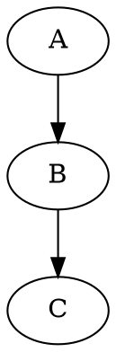

# Diagram compatibility

## ECharts

```echarts
{animation: false, xAxis: {type: 'category', data: ['A', 'B']}, yAxis: {type: 'value'}, series: [{type: 'bar', data: [3, 7]}]}
```

## Graphviz



## Flowchart

```flowchart
st=>start: Start
e=>end: End
st->e
```

## WaveDrom

```wavedrom
{signal: [{name: 'clk', wave: 'p...'}, {name: 'data', wave: 'x.23', data: ['A', 'B']}]}
```

## Markmap

```markmap
# Topic
## Branch A
## Branch B
```

## ABC notation

```abc
X:1
T:Scale
M:4/4
L:1/4
K:C
CDEF|GABc|
```

## SMILES

```smiles
C1=CC=CC=C1
```
